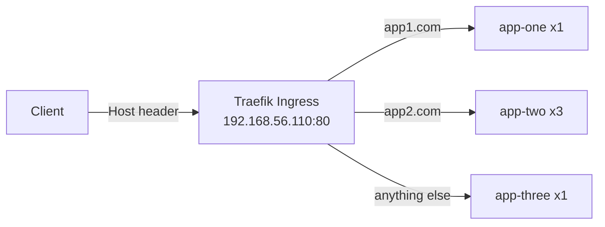
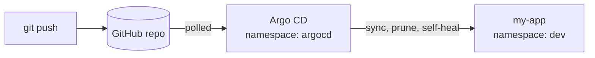
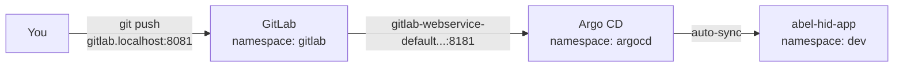

# Inception-of-Things 

A hands-on introduction to Kubernetes built in four stages: a multi-node **K3s** cluster on **Vagrant** VMs, **Ingress** routing between several apps, a **GitOps** pipeline with **K3d** and **Argo CD**, and, as a bonus, a self-hosted **GitLab** running inside the cluster as the Git source.


---

## Table of contents

- [Repository layout](#repository-layout)
- [Prerequisites](#prerequisites)
- [Part 1: K3s and Vagrant](#part-1-k3s-and-vagrant)
- [Part 2: K3s and three apps behind Ingress](#part-2-k3s-and-three-apps-behind-ingress)
- [Part 3: K3d and Argo CD (GitOps)](#part-3-k3d-and-argo-cd-gitops)
- [Bonus: Self-hosted GitLab](#bonus-self-hosted-gitlab)
- [The demo app](#the-demo-app)
- [Helper scripts](#helper-scripts)
- [Troubleshooting](#troubleshooting)
- [Known limitations](#known-limitations)

---

## Repository layout

```
.
├── p1/                     # Part 1: two-node K3s cluster (server + worker)
│   └── Vagrantfile
├── p2/                     # Part 2: single K3s node, 3 apps + Ingress
│   ├── Vagrantfile
│   ├── setup.sh            # VM provisioning: installs K3s, applies manifests
│   ├── apps.yaml           # 3 Deployments + 3 Services
│   └── ingress.yaml        # Host-based routing (app1.com / app2.com / default)
├── p3/                     # Part 3: K3d cluster + Argo CD
│   ├── setup.sh            # Installs k3d, kubectl, argocd CLI; creates cluster
│   └── argocd-app.yaml     # Argo CD Application tracking a GitHub repo
├── bonus/                  # Bonus: GitLab inside the cluster as Argo CD's source
│   ├── scripts/setup.sh    # Full install: Docker, k3d, kubectl, Helm, Argo CD, GitLab
│   └── confs/
│       ├── values.yaml     # GitLab Helm values (HTTP, no cert-manager)
│       ├── app.yaml        # Argo CD Application pointing to in-cluster GitLab
│       └── deployment.yaml # Manifest pushed to GitLab and synced by Argo CD
├── my-app/                 # Flask demo app used in Part 2 (guuts/my-app image)
│   ├── app.py
│   ├── dockerfile
│   └── requirements.txt
├── script.sh               # 42 campus helper: moves Vagrant/VirtualBox data to ~/goinfre
└── clean.sh                # Full teardown: k3d clusters, Vagrant VMs, Docker, kubeconfig
```

---

## Prerequisites

| Part      | Host requirements                                                                   |
|-----------|-------------------------------------------------------------------------------------|
| p1, p2    | [VirtualBox](https://www.virtualbox.org/) and [Vagrant](https://www.vagrantup.com/) |
| p3        | Docker running on the host (the script installs `k3d`, `kubectl` and `argocd`)       |
| bonus     | A Debian/Ubuntu machine or VM with `sudo` and at least **8 GB of RAM** (GitLab is heavy) |

All VMs use the `debian/bullseye64` box on the `192.168.56.0/24` host-only network.

---

## Part 1: K3s and Vagrant

Two Debian VMs make up a K3s cluster:

| VM           | Role             | IP               | CPU | RAM     |
|--------------|------------------|------------------|-----|---------|
| `abel-hidS`  | K3s server       | `192.168.56.110` | 1   | 1024 MB |
| `abel-hidSW` | K3s agent/worker | `192.168.56.111` | 1   | 1024 MB |

The server installs K3s and writes its join token to the shared `/vagrant` folder. The worker waits for that file, then joins the cluster at `https://192.168.56.110:6443`.

```bash
cd p1
vagrant up

# Check that both nodes are Ready
vagrant ssh abel-hidS -c "kubectl get nodes -o wide"
```

Expected output:

```
NAME         STATUS   ROLES                  AGE   VERSION   INTERNAL-IP
abel-hidS    Ready    control-plane,master   ...   ...       192.168.56.110
abel-hidSW   Ready    <none>                 ...   ...       192.168.56.111
```

> The alias `k=kubectl` is added to the `vagrant` user's shell on the server.

---

## Part 2: K3s and three apps behind Ingress

A single K3s server (`192.168.56.110`, 4 CPU, 2 GB RAM) runs three web apps. K3s ships with Traefik, which handles the Ingress and routes requests by the `Host` header:

| Host         | Service     | Replicas |
|--------------|-------------|----------|
| `app1.com`   | `app-one`   | 1        |
| `app2.com`   | `app-two`   | 3        |
| any other    | `app-three` | 1 (default backend) |



```bash
cd p2
vagrant up
```

`setup.sh` installs K3s, applies [apps.yaml](p2/apps.yaml), waits for every Deployment to become available, then applies [ingress.yaml](p2/ingress.yaml).

**Test it**

```bash
curl -H "Host: app1.com" http://192.168.56.110
curl -H "Host: app2.com" http://192.168.56.110   # repeat it: the pod name changes across the 3 replicas
curl http://192.168.56.110                       # served by app3
```

To test in a browser, add this line to your host's `/etc/hosts`:

```
192.168.56.110  app1.com app2.com app3.com
```

---

## Part 3: K3d and Argo CD (GitOps)

There are no VMs in this part. K3d runs K3s inside Docker containers, and Argo CD keeps the `dev` namespace in sync with a public GitHub repository.



```bash
cd p3
bash setup.sh                         # creates cluster "mycluster" (1 server + 1 agent)
kubectl apply -f argocd-app.yaml      # registers the Application
```

The script creates the `argocd` and `dev` namespaces, installs Argo CD from the stable manifests, prints the admin password and starts a port-forward to **https://localhost:8443** (user `admin`).

The Application ([argocd-app.yaml](p3/argocd-app.yaml)) tracks `https://github.com/abel-hid/test.git` on branch `master` with automated sync, `prune` and `selfHeal` enabled.

**Demo: switching versions**

```bash
# In the tracked GitHub repo, change the image tag (for example v1 -> v2), then:
git commit -am "bump to v2" && git push

# Argo CD picks up the change and rolls it out:
kubectl get pods -n dev -w
kubectl port-forward -n dev svc/<service-name> 8888:8888
curl http://localhost:8888/
```

> `setup.sh` downloads the **macOS (darwin/amd64)** builds of `kubectl` and `argocd`. On Linux, replace `darwin` with `linux` in the download URLs.

---

## Bonus: Self-hosted GitLab

This part replaces GitHub with a GitLab instance running **inside the same cluster**. Argo CD pulls from GitLab's internal service address, so nothing leaves the cluster.



### What the script does

[bonus/scripts/setup.sh](bonus/scripts/setup.sh) is idempotent and skips any step that is already done:

1. Installs Docker, k3d, kubectl and Helm.
2. Creates the k3d cluster `mycluster` (1 server + 1 agent), with Traefik disabled and host port **8081** mapped to the load balancer.
3. Writes the kubeconfig to `~/.kube/config` and adds `gitlab.localhost` to `/etc/hosts`.
4. Installs **Argo CD** with Helm (Dex and notifications disabled).
5. Installs **GitLab** chart `9.10.1` with Helm using [values.yaml](bonus/confs/values.yaml): HTTP only, nginx-ingress, no cert-manager, one replica per component, no runner. Then it waits for the migrations job to complete.
6. Applies [app.yaml](bonus/confs/app.yaml) and prints both sets of credentials.

### Run it

```bash
sudo bash bonus/scripts/setup.sh
```

> ⚠️ Before running, update `VALUES_FILE`, `APP_FILE` and `USER` at the top of the script so they match your machine. They are currently hard-coded to `/home/abel-hid/Desktop/IoT-1/...`.

The GitLab install can take **15–30 minutes**.

### Access

| Service | URL                                   | Username | Password                       |
|---------|---------------------------------------|----------|--------------------------------|
| GitLab  | http://gitlab.localhost:8081          | `root`   | printed at the end of the script |
| Argo CD | http://localhost:9090 (after port-forward) | `admin`  | printed at the end of the script |

```bash
kubectl -n argocd port-forward svc/argocd-server 9090:443
```

To print the passwords again:

```bash
kubectl -n gitlab get secret gitlab-gitlab-initial-root-password -o jsonpath='{.data.password}' | base64 -d; echo
kubectl -n argocd get secret argocd-initial-admin-secret        -o jsonpath='{.data.password}' | base64 -d; echo
```

### Push the app to GitLab

1. In GitLab, create a **blank public project** named `abel-hid` under `root`.
2. Push the manifest:

   ```bash
   mkdir abel-hid && cd abel-hid
   cp ../bonus/confs/deployment.yaml .
   git init -b main
   git add . && git commit -m "initial deployment"
   git remote add origin http://gitlab.localhost:8081/root/abel-hid.git
   git push -u origin main
   ```

3. Argo CD syncs `wil42/playground:v1` into the `dev` namespace. Change the tag to `v2`, push again, and watch it roll out:

   ```bash
   kubectl -n dev port-forward svc/abel-hid-service 8888:80
   curl http://localhost:8888/    # {"status":"ok","message":"v1"} -> "v2"
   ```

---

## The demo app

[my-app/](my-app/) is a small Flask service that listens on port **8888** and is used in Part 2 (image `guuts/my-app`).

| Route  | Response                                                              |
|--------|-----------------------------------------------------------------------|
| `/`    | HTML page showing the app name, pod name, node name and version       |
| `/api` | JSON: `{status, message, pod, node, version}`                         |

It reads `APP_NAME`, `POD_NAME` and `NODE_NAME` from the environment. In Kubernetes these values come from the Downward API, so every replica reports its own identity.

```bash
cd my-app
docker build -t <your-user>/my-app:v2 -f dockerfile .
docker run --rm -p 8888:8888 -e APP_NAME=local <your-user>/my-app:v2
docker push <your-user>/my-app:v2
```

---

## Helper scripts

| Script                     | Purpose                                                                                                                                                   |
|----------------------------|-----------------------------------------------------------------------------------------------------------------------------------------------------------|
| [script.sh](script.sh)     | **42 campus machines:** moves `VAGRANT_HOME` and the VirtualBox machine folder to `~/goinfre` so VMs don't fill your home quota. It also deletes `~/.vagrant.d`, `./.vagrant` and `~/VirtualBox VMs`. |
| [clean.sh](clean.sh)       | **Destructive** full reset: deletes every k3d cluster and Vagrant VM, **every Docker container, image, volume and network**, `~/.kube`, and the GitLab/Argo entries in `/etc/hosts`. |

```bash
bash script.sh          # once per session on campus
sudo bash clean.sh      # wipes everything, use with care
```

---

## Troubleshooting

| Symptom | Fix |
|---------|-----|
| Worker in p1 never joins | Check that `p1/node-token` exists and that the worker can reach `192.168.56.110:6443`. Run `vagrant provision abel-hidSW` to retry. |
| VirtualBox refuses the `192.168.56.x` network | Allow the range in `/etc/vbox/networks.conf`: `* 192.168.56.0/21` |
| p2 Ingress returns 404 | Wait until Traefik is running: `kubectl get pods -n kube-system`. Check that the `Host` header is correct. |
| Argo CD app shows `Unknown` / `ComparisonError` | Make sure the repository is reachable. In the bonus, the GitLab project must be **public** and the branch must be `main`. |
| GitLab pods stuck in `Pending` / `OOMKilled` | Give the host more RAM (8 GB minimum) and check `kubectl describe pod -n gitlab <pod>`. |
| `gitlab.localhost` doesn't resolve | Check `/etc/hosts` for `127.0.0.1 gitlab.localhost`. |

Commands that help with most issues:

```bash
kubectl get all -A
kubectl get applications -n argocd
kubectl describe application my-app -n argocd
kubectl logs -n argocd deploy/argocd-repo-server
```

---

## Known limitations

- `bonus/scripts/setup.sh` has absolute paths and a default user (`abel-hid`) hard-coded, and references `$PROJECT_NAME`, which is never defined. With `set -u`, the final "Next manual steps" message fails if GitLab was just installed.
- `bonus/confs/values.yaml` declares the `certmanager:` key twice. YAML keeps the last one.
- `p3/setup.sh` targets macOS binaries and uses fixed `sleep`s instead of readiness checks.
- The Argo CD repo URLs (`abel-hid/test` and `root/abel-hid`) are specific to the author. Point them to your own repositories.
